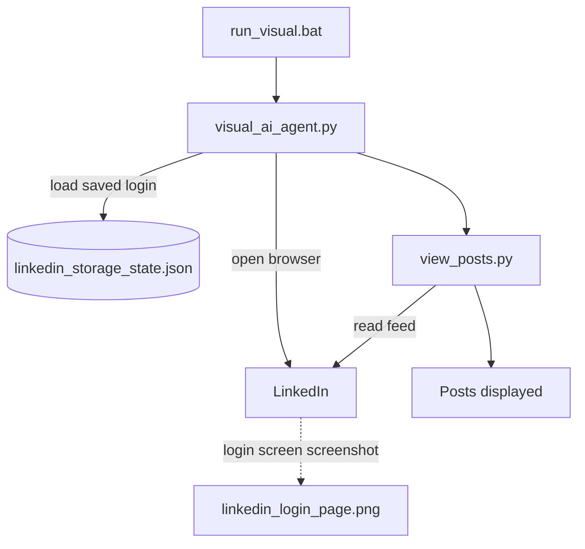

# linkedin_Agent

A visual AI agent that opens LinkedIn with a saved login session and views posts.

## How it works

## Files

| File | Purpose |
|------|---------|
| `visual_ai_agent.py` | Main agent: controls the browser and runs the AI steps |
| `view_posts.py` | Opens the feed and reads posts |
| `run_visual.bat` | Windows launcher for the agent |
| `linkedin_storage_state.json` | Saved login session (cookies) |
| `linkedin_login_page.png` | Screenshot of the login page |

## Setup

1. Install Python 3.9 or newer.
2. Install the dependencies used by the scripts (for example, `pip install playwright` followed by `playwright install`).
3. Run `run_visual.bat` on Windows, or `python visual_ai_agent.py` on other systems.

